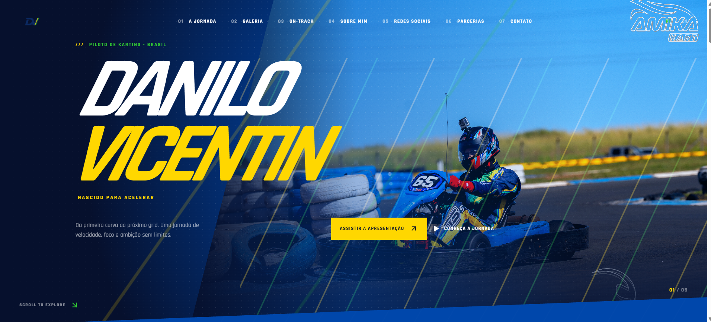

# 🏎️ Danilo Vicentin - Racing Portfolio



<div align="center">

**Piloto de Karting • Brasil**

*Nascido para acelerar*

[](https://nextjs.org/)
[](https://www.typescriptlang.org/)
[](https://tailwindcss.com/)
[](https://www.framer.com/motion/)

</div>

---

## 📖 Sobre

Portfolio profissional desenvolvido para **Danilo Vicentin**, piloto de karting brasileiro. Este projeto apresenta uma jornada visual impressionante através de animações fluidas, design moderno e performance otimizada.

### ✨ Características

- 🎨 **Design Premium**: Paleta de cores única com azul, verde limão e dourado
- 🚀 **Performance Otimizada**: Carregamento rápido com Next.js 13 e React 18
- 🎬 **Animações Fluidas**: Transições suaves usando Framer Motion
- 📱 **Totalmente Responsivo**: Experiência perfeita em todos os dispositivos
- 🌐 **Multi-idioma**: Suporte para Português e Inglês
- 🧹 **Clean Code**: Arquitetura modular e componentes reutilizáveis

---

## 🛠️ Tecnologias

### Frontend
- **Next.js 13.5** - Framework React com App Router
- **TypeScript** - Tipagem estática para maior segurança
- **Tailwind CSS** - Estilização utilitária
- **Framer Motion** - Biblioteca de animações
- **Lucide React** - Ícones modernos e consistentes

### Arquitetura
- **Component-Based**: Componentes reutilizáveis e modulares
- **Separation of Concerns**: Lógica, dados e UI separados
- **DRY Principle**: Evitação de duplicação de código
- **Type Safety**: TypeScript para prevenção de erros

---

## 📁 Estrutura do Projeto

```
projeto-piloto/
├── app/                    # App Router do Next.js
│   ├── about/             # Página Sobre Mim
│   ├── on-track/          # Página On-Track
│   ├── layout.tsx         # Layout global
│   ├── page.tsx           # Página inicial
│   └── globals.css        # Estilos globais
├── components/            # Componentes React
│   ├── shared/            # Componentes compartilhados
│   │   ├── Header.tsx     # Cabeçalho reutilizável
│   │   ├── Footer.tsx     # Rodapé reutilizável
│   │   └── MagneticButton.tsx  # Botão magnético
│   └── ui/                # Componentes UI (shadcn/ui)
├── lib/                   # Utilitários e constantes
│   ├── constants.ts       # Constantes globais
│   └── data.ts            # Dados centralizados
├── public/                # Arquivos estáticos
│   ├── Imagens/           # Imagens do projeto
│   └── Marca/             # Logo e marca
└── hooks/                 # Custom Hooks
```

---

## 🚀 Instalação

```bash
# Clone o repositório
git clone https://github.com/seu-usuario/projeto-piloto.git

# Entre no diretório
cd projeto-piloto

# Instale as dependências
npm install

# Execute o servidor de desenvolvimento
npm run dev
```

Abra [http://localhost:3000](http://localhost:3000) no seu navegador.

---

## 📦 Scripts Disponíveis

| Comando | Descrição |
|---------|-----------|
| `npm run dev` | Inicia o servidor de desenvolvimento |
| `npm run build` | Cria uma build de produção |
| `npm start` | Inicia o servidor de produção |
| `npm run lint` | Executa o linter ESLint |

---

## 🎨 Paleta de Cores

| Cor | Hex | Uso |
|-----|-----|-----|
| Azul Cobalto | `#0047ab` | Primary, backgrounds |
| Verde Limão | `#32cd32` | Acentos, destaques |
| Dourado | `#ffd700` | Efeitos especiais, badges |
| Tinta | `#06102d` | Background principal |
| Muted | `#a7b7d7` | Textos secundários |

---

## 🌟 Destaques do Código

### Componentes Compartilhados
```typescript
// Header reutilizável em todas as páginas
<Header
  lang={lang}
  onLangChange={() => setLang(lang === "pt" ? "en" : "pt")}
  navItems={NAV_ITEMS[lang]}
  navLinks={NAV_LINKS}
/>

// Footer consistente em todo o site
<Footer basePath="" />
```

### Constantes Centralizadas
```typescript
// lib/constants.ts
export const NAV_ITEMS = {
  pt: ["A jornada", "Galeria", "On-Track", ...],
  en: ["The journey", "Gallery", "On-Track", ...],
} as const
```

### Dados Separados
```typescript
// lib/data.ts
export const photos = [...] as const
export const socialCards = [...] as const
```

---

## 📱 Páginas

### 🏠 Home (`/`)
- Hero section com animações
- Journey section com história
- Galeria de fotos
- Redes sociais
- Parcerias e contato

### 👤 Sobre Mim (`/about`)
- Biografia do piloto
- Foto destacada
- Links para redes sociais
- Design consistente com o site

### 🏁 On-Track (`/on-track`)
- Estatísticas de corridas
- Resultados de campeonatos
- Status da temporada atual
- Histórico de performances

---

## 🎯 Otimizações Aplicadas

### Performance
- ✅ Code splitting automático com Next.js
- ✅ Lazy loading de imagens
- ✅ Otimização de animações com Framer Motion
- ✅ Componentes compartilhados para evitar duplicação

### Code Quality
- ✅ TypeScript para type safety
- ✅ ESLint para consistência
- ✅ Clean code principles
- ✅ Componentes modulares e reutilizáveis
- ✅ Separação de concerns

### Manutenibilidade
- ✅ Constantes centralizadas
- ✅ Dados separados da UI
- ✅ Componentes reutilizáveis
- ✅ Nomes descritivos e claros

---

## 🤝 Contribuindo

Contribuições são bem-vindas! Sinta-se à vontade para:

1. Fork o projeto
2. Crie uma branch para sua feature (`git checkout -b feature/AmazingFeature`)
3. Commit suas mudanças (`git commit -m 'Add some AmazingFeature'`)
4. Push para a branch (`git push origin feature/AmazingFeature`)
5. Abra um Pull Request

---

## 📄 Licença

Este projeto está sob a licença MIT. Veja o arquivo [LICENSE](LICENSE) para mais detalhes.

---

## 👨‍💻 Autor

**Danilo Vicentin**

- Instagram: [@danilo_vicentin_silva](https://www.instagram.com/danilo_vicentin_silva/)
- YouTube: [@danilovicentin](https://www.youtube.com/@danilovicentin)
- TikTok: [@danilovicentindasilva](https://www.tiktok.com/@danilovicentindasilva)

---

<div align="center">

**"Nunca Desistir"** 🏁

Feito com ❤️ e muito código limpo

</div>
